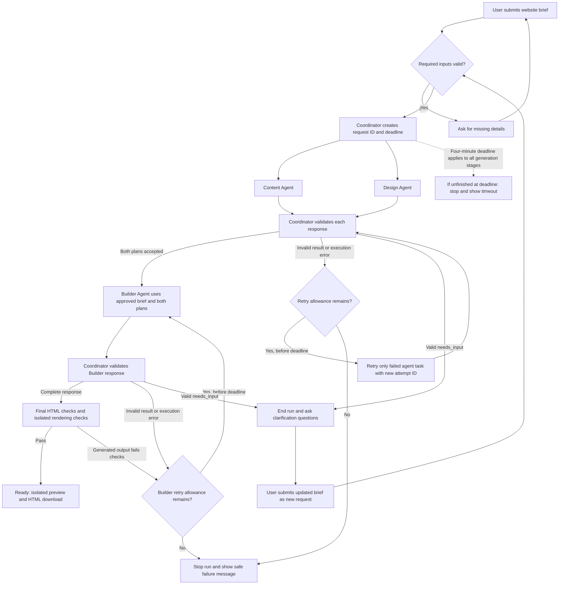

# SiteStarter architecture

Coordinator is application code, not an AI agent. Three AI agents perform content planning, design planning, and HTML building.

The planning retry box runs only the failed Content or Design task. It does not launch both planners again. Both plans must be accepted before the Builder starts. A Builder retry reuses the same accepted plans and gets a new attempt ID.

## Rules applying throughout

- Every agent task has a request ID and its own active attempt ID. The Coordinator rejects mismatched IDs, late responses, duplicate responses, and responses for ended runs.
- Each task gets two total attempts: the original and one retry shared across invalid output, errors, and timeouts. Each execution attempt has a 45-second limit. No retry extends the four-minute run deadline.
- Final validation includes required sections, supplied facts and contact details, prohibited scripts and external resources, accepted design requirements, contrast, and mobile layout. Ordinary approved contact links are allowed; embedded feeds and loaded external assets are not.
- Preview and download become available only after all final checks pass. Rendering checks run in an isolated environment before user access.
- Clarification ends the old run. The updated brief receives a new request ID, fresh attempt IDs and budgets, and a new deadline; both planners rerun. Old plans are not reused.
- Only Coordinator application code writes authoritative workflow state. It atomically accepts results and updates task states, preventing duplicate Builder starts.
- Records live in server memory in one application process and belong to the originating session. Server restart loses records. Delete session records after 30 minutes without user activity; background polling does not extend the period. Invalidate outstanding attempts before deletion so late callbacks cannot recreate records.
- Timeout, failure, clarification, and expiration must not appear as Ready. Cancellation is best effort; rejecting stale results is mandatory.

## Ownership

| Component | Owner | Reviewer |
|---|---|---|
| Content Agent | Racheal | Sam |
| Coordinator | Racheal | Sam |
| Interface | Racheal | Sam |
| End-to-end tests | Racheal | Sam |
| Design Agent | Sam | Racheal |
| Builder Agent | Sam | Racheal |
| Final HTML validation and preview isolation | Sam | Racheal |

This diagram documents the agreed design; executable schemas, framework and model-provider choices, implementation, and verification remain separate work.
