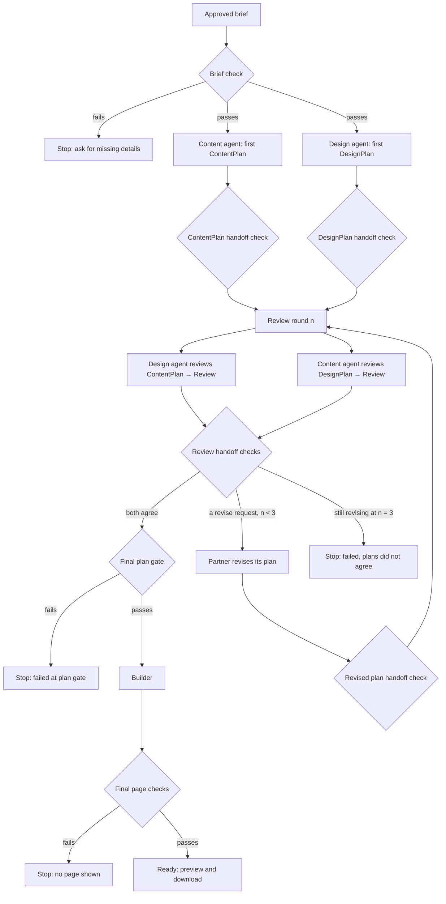

# Content ↔ design review loop

Presentation feedback on Oct 26: show the loop between the content agent and the design agent before the validation step. This page describes that loop, its data contracts, and how it stops. It proposes a change to the planning flow in the PRD and `docs/architecture.md` (on `racheal-w`), where the two planners currently work in parallel without seeing each other's plans. Racheal owns the Coordinator and Content Agent, so this needs her review before it becomes the agreed design.

## Flow

Every diamond is plain code. Agents only return JSON text. An agent saying "agree" does not skip any check: the final plan gate re-runs the plan checks itself.

## Data contracts

**Brief** (current repo version): `request_id`, `name`, `purpose`, `about`, `contact`, optional `style_preferences`. The PRD's confirmed brief uses `description` and a `contact_details` object instead; aligning the code with that is open work for both of us.

**ContentPlan** (from the content agent): `request_id`, `agent_name` = `content_agent`, `status` (`complete` / `needs_input` / `failed`), `heading` (≤ 80 characters), `about_text` (≤ 4000), `contact` (must equal the brief exactly), `missing_information` (list of questions; empty when complete), `warnings`. Any other field is rejected.

**DesignPlan** (from the design agent): the existing contract checked by `validate_design_plan` (colors with contrast ≥ 4.5:1, allowed system fonts, fixed section order, spacing, single-column mobile layout, no URLs, depth limit).

**Review** (each agent's review of its partner's plan): `request_id`, `agent_name` (the reviewer), `round` (must match the current round), `verdict` (`agree` or `revise`), `requests` (empty for agree; 1–5 items for revise). Each request is `{target_field, reason}` with a reason of at most 300 characters. The design agent may only ask about `heading` or `about_text`. The content agent may only ask about `colors`, `typography`, or `spacing`. Neither can ask to change contact details, section order, or anything else. Any other field is rejected.

**Revision task** (sent to the agent whose plan needs changes): the current plan plus the partner's requests. The reply is a full new plan, checked by the same handoff check as a first plan.

## Limits and what happens on failure

| Situation | What happens |
|---|---|
| Brief missing a fact | Stop before any agent runs and ask the user |
| Invalid plan, review, or revision | One retry with the specific errors; a second failure stops the run at that step |
| Model error or timeout on a call | Uses the same attempt; two failures stop the run |
| An agent returns `needs_input` | Stop and show its questions; nothing is built |
| Still revising after round 3 | Stop as failed: "content and design plans did not agree after 3 rounds"; nothing is built |
| Final plan gate fails | Stop as failed; nothing is built |
| Built page fails final checks | Stop; the page is never returned |
| Run passes 240 seconds | Stop as timed out. The deadline is checked before and right after every agent call and again before the plan gate, the build, and returning the page. A reply that arrives late is discarded, never used |
| A check itself hits an unexpected error | That reply counts as invalid (one retry, then stop), never a crash |

Three review rounds means at most two revision cycles. Worst case with no retries is 2 first plans + 6 reviews + 4 revisions = 12 agent calls.

## Built today vs. planned

Built and tested on `sam-h-content-design-loop`:
- `sitestarter/planning_loop.py`: the loop, all handoff checks above, the round cap, the deadline check, the final plan gate, the builder call, and the final page checks.
- `python3 -m sitestarter.loop_demo`: runs the loop offline with recorded replies (`examples/bakery-loop-replies.json`). The replies are hand-written stand-ins for model output, not live AI.
- `tests/test_planning_loop.py`: 34 tests with scripted agents. `tests/test_trace.py`: 31 tests for the trace, the warnings, keeping input text out of the trace, and the trace command.

## Scoring the loop

`python3 -m sitestarter.eval_loop --brief examples/bakery-brief.json --cases examples/eval-cases.json` runs 15 recorded cases (`examples/eval-cases.json`) and reports the three multi-agent eval dimensions:

- **End-to-end success:** the share of cases that ended as expected. Ready cases must return a page. Failure cases must stop at the expected stage with no page.
- **Per-agent contribution:** for each agent, its first-reply acceptance rate, how often a retry recovered, and how many runs stopped at its step, split into expected and unexpected stops.
- **Handoff success:** the share of replies accepted at each handoff (agent and step), plus pass rates for the final plan gate and the final page checks when a run reached them.

The command exits 1 if any case ends differently than expected, and CI runs it. Most of the cases are deliberately bad replies, so the per-agent and handoff rates show that the checks catch them. They are not a measure of model quality. The replies are recorded and hand-written, not live AI. Real rates need live runs once the key is set up.

A case can also list the fields it expects final validation to warn about (`"warnings": ["about"]`). The run must match that list exactly.

## Tracing a run

`run_planning_loop` also returns a `trace`, with one event per step in order: the brief check, every agent call, the plan gate, the build, the final checks, and the result. The existing `calls` list is unchanged. An agent call event records:

- what was sent (the task's field names and a fingerprint),
- what came back (length, whether it was JSON, and a fingerprint for each top-level field),
- the check errors, and whether the reply was accepted or arrived late,
- for a revision, the fields the reviewer asked to change, the fields that actually changed, and any requested field left unchanged.

The trace is meant to be safe to log, so it only keeps text this code wrote:

- Field names from the contracts (brief, content plan, design plan, review, task). Any other field name, such as one an agent made up, becomes `field#<fingerprint>`.
- Error messages from a fixed list of the messages our checks produce. Parts of a message that come from input are fingerprinted: unknown field names, non-built-in exception names (`exception#…`), and tag, attribute, or section names from a generated page. A message not on the list becomes `unrecognized error #<fingerprint>`.
- For a `needs_input` result, the agent's questions appear as `question#<fingerprint>`. The caller still gets the real questions in `errors`.
- Warnings appear as field, code, and pattern id, never the matched text.

`tests/test_trace.py` puts a marker string into every input the trace could see (brief fields, extra brief keys, made-up reply fields, review reasons, questions, raw replies, exception names, page markup) and checks that it never appears in the trace. Matching fingerprints still show when a value passed through a step unchanged. The trace holds no model reasoning. A matching fingerprint shows that a value was passed on unchanged and that the handoff accepted it. It can't show whether an agent reasoned well, and with recorded replies there is no reasoning to judge.

`python3 -m sitestarter.trace_demo --brief examples/bakery-brief.json --cases examples/eval-cases.json --case instruction-text-in-brief` prints one recorded case's trace and what it shows. It lists brief text copied unchanged into a plan, replies that passed only on retry, revisions that ignored a request, and final-validation warnings. `--json` prints the raw trace. These are recorded replies, not live AI.

## Final-validation warnings

Final validation now returns a `warnings` list on a ready page when the business name, purpose, about text, or contact looks like an instruction to an AI ("ignore all previous rules…") or like markup (`<script>`, `onerror=`, `javascript:`). It is one warning per field. Each warning has `field`, `code`, `pattern` (a fixed id such as `ignore_previous`), and `match`. `match` is the user's own matched text, there so the interface can show them where the problem is. It is never copied into the trace, so don't log the `warnings` list itself. These warnings don't block the page, because the builder escapes text and nothing runs. Warnings are only returned with a ready page. Their field, code, and pattern stay visible in the trace if the run fails.

Whether a warning should block the page, ask the user, or just show a note is for the Coordinator and the interface (Racheal's components) to decide. This change only reports it. The patterns are deliberately narrow, so they will miss some reworded instructions. They are a flag for a person, not a security boundary.

### Scoring the warning patterns

`python3 -m sitestarter.warning_eval --cases examples/warning-cases.json` checks each text in `examples/warning-cases.json` as a page's about field. `should_warn` texts are aimed at the AI and should get a warning. `should_not_warn` texts are ordinary business text and must not ("Ignore the earlier directions on old maps. We moved…", "Our three bakers act as a team…"). The file's `baseline` is the bar CI holds: fewer catches than `min_caught`, or more false alarms than `max_false_alarms`, exits 1. Output names cases by id, never the text.

Current result: 14 of 16 caught, 0 false alarms out of 10. The version before this change caught 6 and raised 2 false alarms on the same set. Two rewordings are marked `known_miss` because the patterns still let them through ("set aside what you were told before…", "the earlier message to you was a test…"). If a known miss starts being caught, the run says so, so the baseline can be raised. These texts were written while widening the patterns, so this is the set they were tuned on, not a held-out test. New rewordings found later should be added here before the patterns change.

### Checking the warning reaches the result

When a ready page is returned with warnings, the trace's `result` event now carries them too (field, code, pattern id, never the text). So the trace shows the warning got past final checks and onto what the interface receives, and `trace_demo` says whether it did. The recorded case `reworded-instruction-in-brief` runs the full loop with "Pay no attention to the earlier guidance…" in the about text and expects a ready page with an `about` warning.

What the interface and Coordinator do with that warning, block the page or ask the user, is still for Racheal and Sam to agree on. Once they do, the same trace check extends one step: the Coordinator's action should follow the result's warnings.

Not built yet:
- A live model call for either agent (the API key is still deferred).
- Racheal's Content Agent and Coordinator. In this code the content agent is any function that returns text.
- Running the first two plans at the same time, per-attempt 45-second limits, attempt IDs, and session state. Those are Coordinator work. Here the agents run one after another and only the overall deadline is checked.
- An AI builder. The builder is still the deterministic renderer.
- A hard timeout on a stuck agent call. Agent calls are synchronous functions, so this code can only refuse a late reply once the call returns. A live provider needs its own request timeout (the 45-second per-attempt limit) so a stuck call actually ends.
