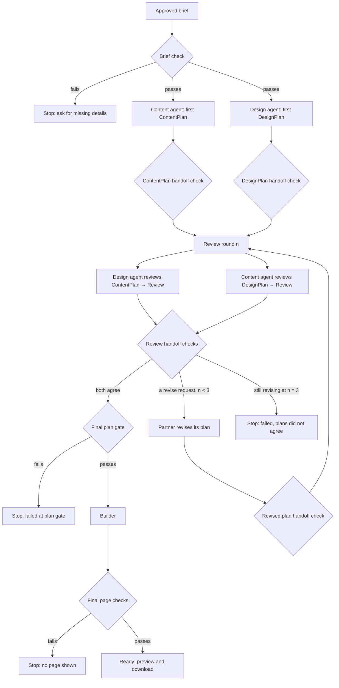

# Content ↔ design review loop

Presentation feedback on Oct 26: show the loop between the content agent and the design agent before the validation step. This page describes that loop, its data contracts, and how it stops. It proposes a change to the planning flow in the PRD and `docs/architecture.md` (on `racheal-w`), where the two planners currently work in parallel without seeing each other's plans. Racheal owns the Coordinator and Content Agent, so this needs her review before it becomes the agreed design.

## Flow

Every diamond is plain code. Agents only return JSON text. An agent saying "agree" does not skip any check: the final plan gate re-runs the plan checks itself.

## Data contracts

**Brief** (current repo version): `request_id`, `name`, `purpose`, `about`, `contact`, optional `style_preferences`. The PRD's confirmed brief uses `description` and a `contact_details` object instead; aligning the code with that is open work for both of us.

**ContentPlan** (from the content agent): `request_id`, `agent_name` = `content_agent`, `status` (`complete` / `needs_input` / `failed`), `heading` (≤ 80 characters), `about_text` (≤ 4000), `contact` (must equal the brief exactly), `missing_information` (list of questions; empty when complete), `warnings`. Any other field is rejected.

**DesignPlan** (from the design agent): the existing contract checked by `validate_design_plan` (colors with contrast ≥ 4.5:1, allowed system fonts, fixed section order, spacing, single-column mobile layout, no URLs, depth limit).

**Review** (each agent's review of its partner's plan): `request_id`, `agent_name` (the reviewer), `round` (must match the current round), `verdict` (`agree` or `revise`), `requests` (empty for agree; 1–5 items for revise). Each request is `{target_field, reason}` with a reason of at most 300 characters. The design agent may only ask about `heading` or `about_text`. The content agent may only ask about `colors`, `typography`, or `spacing`. Neither can ask to change contact details, section order, or anything else. Any other field is rejected.

**Revision task** (sent to the agent whose plan needs changes): the current plan plus the partner's requests. The reply is a full new plan, checked by the same handoff check as a first plan.

## Limits and what happens on failure

| Situation | What happens |
|---|---|
| Brief missing a fact | Stop before any agent runs and ask the user |
| Invalid plan, review, or revision | One retry with the specific errors; a second failure stops the run at that step |
| Model error or timeout on a call | Uses the same attempt; two failures stop the run |
| An agent returns `needs_input` | Stop and show its questions; nothing is built |
| Still revising after round 3 | Stop as failed: "content and design plans did not agree after 3 rounds"; nothing is built |
| Final plan gate fails | Stop as failed; nothing is built |
| Built page fails final checks | Stop; the page is never returned |
| Run passes 240 seconds | Stop as timed out. The deadline is checked before and right after every agent call and again before the plan gate, the build, and returning the page. A reply that arrives late is discarded, never used |
| A check itself hits an unexpected error | That reply counts as invalid (one retry, then stop), never a crash |

Three review rounds means at most two revision cycles. Worst case with no retries is 2 first plans + 6 reviews + 4 revisions = 12 agent calls.

## Built today vs. planned

Built and tested on `sam-h-content-design-loop`:
- `sitestarter/planning_loop.py`: the loop, all handoff checks above, the round cap, the deadline check, the final plan gate, the builder call, and the final page checks.
- `python3 -m sitestarter.loop_demo`: runs the loop offline with recorded replies (`examples/bakery-loop-replies.json`). The replies are hand-written stand-ins for model output, not live AI.
- `tests/test_planning_loop.py`: 34 tests with scripted agents.

Not built yet:
- A live model call for either agent (the API key is still deferred).
- Racheal's Content Agent and Coordinator. In this code the content agent is any function that returns text.
- Running the first two plans at the same time, per-attempt 45-second limits, attempt IDs, and session state. Those are Coordinator work. Here the agents run one after another and only the overall deadline is checked.
- An AI builder. The builder is still the deterministic renderer.
- A hard timeout on a stuck agent call. Agent calls are synchronous functions, so this code can only refuse a late reply once the call returns. A live provider needs its own request timeout (the 45-second per-attempt limit) so a stuck call actually ends.
